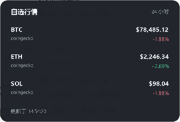
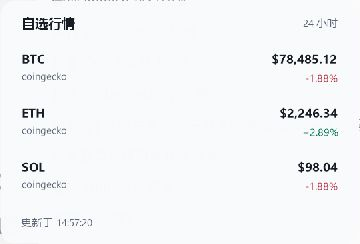

# Crypto Taskbar

在 Windows 任务栏显示自选币价，鼠标停留时展开完整列表。独立运行，不需要 Windhawk。




## 使用

从 [Releases](https://github.com/simulacraliasing/crypto-taskbar/releases/latest) 下载 `CryptoTaskbar.exe`，双击运行。默认显示 BTC、ETH，悬停列表还包含 SOL，每 30 秒更新一次。

- 鼠标停留约 0.3 秒：展开列表；移开后收起。移到列表上可以继续查看。
- 点击币价或托盘图标：固定列表，再点币价收起。
- 列表过长时用鼠标滚轮翻阅，最多可配置 100 个币种。
- 右键币价或托盘图标：刷新、配置、开机启动、退出。开机启动默认关闭。

程序跟随 Windows 的**系统/任务栏颜色模式**，使用透明背景和 Segoe UI 字体。配置窗口提供 JSON 编辑，保存前会检查内容，保存后立即更新。

## 配置

右键 → **配置…**。配置保存在 `%LOCALAPPDATA%\CryptoTaskbar\config.json`；保存时会保留上一次内容为 `config.json.bak`。也可以修改此文件后重启程序。[完整示例](config.example.json)包含三个内置数据源。

| 字段 | 默认值 | 作用 |
|---|---|---|
| `refreshSeconds` | `30` | 刷新间隔，5–86400 秒；实际还受数据源更新频率和限流影响 |
| `visibleCoins` | `2` | 任务栏显示列表前几个币，1–8；悬停显示全部 |
| `width` | `250` | 显示区域宽度，80–1200，按 100% 缩放计 |
| `position` | `"left"` | `left` 从任务栏左边定位，`right` 从系统托盘左边定位 |
| `offset` | `16` | 与上述边缘的距离，按 100% 缩放计 |
| `theme` | `"system"` | 跟随任务栏主题，也可指定 `light` / `dark` |
| `currency` | `"$"` | 价格前缀；只改变显示文字，不换算价格 |
| `showChange` | `false` | 在任务栏上同时显示涨跌幅；悬停列表始终显示接口提供的涨跌幅 |

`coins` 的顺序就是显示顺序，每行指定显示名称、接口代码和数据源：

```json
"coins": [
  { "label": "BTC", "symbol": "bitcoin", "source": "coingecko" },
  { "label": "ETH", "symbol": "ETHUSDT", "source": "binance" },
  { "label": "SOL", "symbol": "SOL-USDT", "source": "okx" }
]
```

不同数据源的代码不同：CoinGecko 用 `bitcoin`，Binance 用 `BTCUSDT`，OKX 用 `BTC-USDT`。这些示例的报价单位分别是 USD、USDT、USDT。

### 自定义数据源

在 `sources` 中新增名称，再在币种里引用。支持返回 JSON 的 HTTP/HTTPS GET 接口，路径采用 [JSON Pointer](https://json.nlohmann.me/features/json_pointer/)：`/data/0/last` 表示 `data` 数组第一项的 `last` 字段。

```json
"custom": {
  "url": "https://example.com/ticker?symbol={symbol}",
  "pricePath": "/data/price",
  "changePath": "/data/change24h",
  "headers": { "Authorization": "Bearer %PRICE_API_TOKEN%" }
}
```

- `{symbol}` 在 URL 中会转义，在路径中会替换成当前币的代码。
- `{ids}` 会替换成使用同一数据源的所有币代码，以逗号分隔。相同数据源、相同 URL 的请求会合并，默认 CoinGecko 自选列表只发一次请求。
- `pricePath` 可以读取 JSON 数字或数字字符串。`changePath` 可省略，单位是百分数，如 `2.5` 表示 `+2.50%`。
- 接口只给 24 小时开盘价时，使用 `openPath`，程序按 `(当前价格 / 开盘价 - 1) × 100` 计算涨跌幅。
- `headers` 可选，支持 Windows `%环境变量%` 引用。设置环境变量后重启程序；个人配置和密钥不要提交到仓库。

读取失败时保留上次价格，币名后显示 `·`，列表显示失败原因和上次更新时间。HTTP 429 后至少等待 60 秒再尝试该数据源。程序不会把接口返回正文、认证头或密钥写入日志，也不会跟随 HTTP 重定向。

## 任务栏适配

目前支持主显示器底部横向任务栏，随缩放和分辨率变化重新定位，任务栏自动隐藏或全屏应用运行时隐藏。源码基于 Win32，已在 Windows 11 Build 26300 检查；Windows 10 和第三方任务栏尚未验证。

它显示在任务栏空白区域，**不会自动让开始按钮、天气或应用图标移位**。如果发生遮挡，调整 `position`、`offset`、`width` 或显示币数。任务栏图标靠左时，通常使用 `right` 更合适。

程序通过系统代理设置访问所配置的行情接口，不需要交易所登录或交易权限。接口价格可能缓存或受限流影响，刷新间隔不等于逐笔行情推送。

## 构建

需要 CMake 3.20+ 和支持 C++17 的 Windows 编译器。JSON 头文件已随源码提供，构建不需要下载依赖。

Visual Studio 2022：

```powershell
cmake -S . -B build -A x64
cmake --build build --config Release --parallel
ctest --test-dir build -C Release --output-on-failure
```

MinGW-w64 + Ninja：

```powershell
cmake -S . -B build -G Ninja -DCMAKE_BUILD_TYPE=Release
cmake --build build --parallel
ctest --test-dir build --output-on-failure
```

`network_tests` 是手动运行的真实接口检查，不放入默认离线测试：

```powershell
cmake --build build --config Release --target network_tests
```

可用参数：`--config "路径\config.json"` 指定单独配置；`--settings` 启动时打开配置窗口。`--preview-light` / `--preview-dark` 使用示意行情并固定展开列表，方便检查配色；`--inspect` 使用真实行情并让窗口出现在界面检查工具中。这些检查模式不会改变 Windows 的主题设置。

MIT License。第三方许可见 [THIRD_PARTY.md](THIRD_PARTY.md)。
